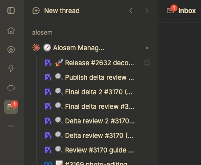

# Operator Inbox

**A place for agent questions that should not get lost in a thread.**

When several agents are working across projects, the next decision can be buried
in a long conversation. Operator Inbox brings those requests into one BB panel,
with the sender, project, supporting links, and a reply field together. Review
an artifact, answer the agent, and return to your work.



[Watch updated demo (MP4)](https://github.com/pixexid/bb-plugin-operator-inbox/releases/download/v0.1.9/op-inbox.mp4)

## Install

Requires BB **0.46.0 or newer** with Plugin SDK **0.6.37 or newer**. Uses the published SDK; no custom
BB build or bb-collab setup is required.

```sh
bb plugin install https://github.com/pixexid/bb-plugin-operator-inbox
```

Review and confirm the installation prompt. Open **Inbox** in BB's navigation.
Agents receive the `send_operator_inbox_message` tool in new sessions.

The Inbox navigation icon shows a badge with the count of unread, unarchived
messages across all projects. Clicking it opens Inbox. The count goes down as
you mark a message read, send a reply, or archive it, and the badge disappears
only when it reaches zero.
Each thread also has an **Inbox** side-panel action scoped to that thread's
project.

## Keep decisions moving

Use Inbox when an agent needs an approval, a choice between options, missing
information, or a review of something concrete. It is especially useful when
you are moving between projects or letting several agents work independently.
A useful message states the decision first, recommends a next step, and links
to the evidence needed to answer it.

Keep routine progress in the working thread. Agents should solve recoverable
problems themselves and finish the work they are already authorized to do
before asking you to decide. Fewer, better requests make the unread count useful.

- **Read:** expand a card to read it; click its header or chevron again to
  collapse it. Messages stay unread until you explicitly use **Mark read** or
  send a reply.
- **Inspect:** open linked images, reports, or web pages using BB's native
  file preview and browser preference. Inbox stays available beside the panel.
- **Reply:** send an answer directly to the original sender thread. Drafts
  survive panel and tab switches for the current BB session. Each message accepts
  one reply. Press **Enter** to send or **Shift+Enter** for a new line;
  continue a longer conversation through **Open sender thread**.
- **Organize:** filter by project and archive handled messages from the
  expanded card actions. Archived messages stay hidden until you choose
  **Show archived**.
- **Feedback:** archive and reply confirmations, plus archive, reply, and
  mark-read errors, appear as BB's native toasts without inserting feedback rows
  that shift the controls. Inbox load errors remain inline.

Cards stay newest-first by creation time. Reading, replying, and archiving do
not reorder the remaining messages. Reading or archiving is **not approval**
and sends no receipt to the agent; only your explicit reply sends text.

## Teach your agents when to use it

Add the following to your **BB-wide `AGENTS.md`** for all projects, or to a
**project's `AGENTS.md`** for a narrower policy. Installing the plugin exposes
the tool; these instructions tell agents how you want it used. The plugin does
not rewrite your instructions or enforce an approval workflow for you.

```markdown
## Operator Inbox

Use send_operator_inbox_message when you need human approval, a decision,
clarification, or review. Send from the thread that owns the request so the
reply returns to the right agent.

- Complete already-authorized work and resolve routine problems before asking.
- Send one concise needs-decision message: decision needed, recommended option,
  relevant evidence/artifact links, and what remains blocked.
- Use urgent only when delay risks time-sensitive harm. Use routine only for
  durable information the operator explicitly wants; keep ordinary progress
  and completion updates in the working thread.
- Do not duplicate the request in chat or send repeated reminders. After
  sending, say "WAITING: operator response in Inbox" and wait for the reply.
- Continue independent authorized work where possible. An unread/read state,
  an archive action, or silence is never approval.
- Include Markdown links to verified URLs and absolute artifact paths. Do not
  send credentials; use the configured secret-handling mechanism instead.
- If the tool is unavailable, report that blocker rather than claiming delivery.
```

### Example tool call

```json
{
  "severity": "needs-decision",
  "text": "Approve the homepage direction? I recommend option B for clearer navigation.\n\n- [Compare designs](https://example.com/design-review)\n\nThe implementation is ready; publishing is waiting for your approval."
}
```

Replace example links with real evidence. Use `[Screenshot](/absolute/path/image.png)`
or `[Report](/absolute/path/REPORT.md)` for local artifacts, rather than embedding
images. Local files open only when the sender's native host context can be
validated; unavailable or unsafe targets remain inert text.

BB supplies the project and sender-thread identity automatically. The tool
accepts only `severity` (`routine`, `needs-decision`, or `urgent`) and `text`.

Replies use BB's thread messaging API. A successful send means BB accepted the
reply as `sent`, `queued`, or `deferred`; it does not prove the agent has read
or acted on it. Inbox is a communication surface, not a task scheduler or an
automatic approval executor.

## Security

- BB plugins are full-trust server code; install only sources you trust.
- Messages and mutations are scoped by the project id captured by BB.
- Agent-authored Markdown is treated as untrusted. Raw HTML is escaped, unsafe
  URL schemes are rejected, and Markdown images render as alt text instead of
  loading remote image beacons.
- The plugin makes no automatic third-party network requests and has no webhooks,
  background workers, schedules, watchers, or polling services.

## Data behavior

Messages live in the plugin-owned SQLite database at
`<bb-data-dir>/plugins/operator-inbox/data.db`. Read, archive, and accepted
reply state are durable across reloads and upgrades. Archiving retains a
message; the plugin has no automatic retention, export, or compatibility
migration from bb-collab state. Back up or remove `data.db` using the same data
handling policy as the rest of your BB installation.

## Development

```sh
npm ci
npm run typecheck
npm test
npm run build
```

`npm run verify` runs typecheck, tests, and `bb plugin build` together.

Message bodies and replies use the existing ReactMarkdown parser with image alt text and escaped raw HTML. HTTP(S) links use BB's UrlLink and its browser preference. Validated local artifacts use button controls calling BB's native experimental_openFilePreview, with no browser href to leak through modified clicks, context menus, or dragging. These controls use normal button keyboard activation; they do not provide the native FileLink context menu.

Sender identity comes from the stored message and native thread/environment/storage APIs, never from the currently selected project or a thread id embedded in a path. Missing or unsafe local targets stay selectable inert text. Workspace and sender-storage paths use their native targets; other absolute paths, including another thread's report, use the verified sender host.

File preview uses an experimental public SDK API and may need updates as BB evolves. Tests exercise the real parser and native navigation intents; installed-client panels require live verification.

## License

MIT
